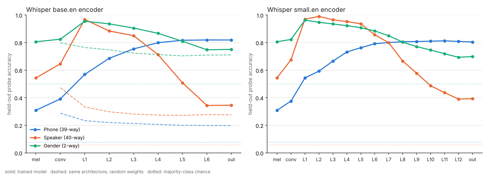

# Who is speaking? Speaker identity inside Whisper's encoder

**AURORA interpretability note · November 2026 · Garfield Wang**

A small, fully reproducible probing-and-erasure study of OpenAI Whisper
(`base.en`, `small.en`) on LibriSpeech test-clean. Probes, the concept eraser and
the WER metric are written from scratch in NumPy, in keeping with AURORA's
no-black-box rule. The whole study runs on a 2-core CPU in a few hours.

## Question

A speech recogniser only needs *what* was said. Does Whisper's encoder also
carry *who* said it, where in the stack, and can that information be removed
without breaking transcription? This matters for privacy: Whisper encoder
features are widely reused as embeddings, and a representation that keeps a
voiceprint leaks identity to anything downstream.

## Setup

- **Data.** 400 utterances from LibriSpeech test-clean: 10 per speaker, all 40
  speakers (20 F / 20 M). 175,977 encoder frames (20 ms each), 145,651 of them
  inside a phone. Phone boundaries come from Montreal Forced Aligner
  TextGrids (Lugosch et al., *LibriSpeech Alignments*, Zenodo 2619474).
- **Representations.** For every frame: the log-mel input (two 10 ms frames
  stacked), the conv stem, the output of each Transformer block, and the final
  `ln_post` output that the decoder cross-attends to.
- **Probes.** Linear softmax regression (Adam, 12 epochs or 6 for gender, weight decay 1e-4)
  on standardised features, one per layer and task:
  - *phone*: 39 ARPAbet classes, **speaker-disjoint** split (8 held-out speakers, 4 F + 4 M);
  - *speaker*: 40-way, **utterance-disjoint** split (each speaker's last 3 of 10 utterances held out);
  - *gender*: 5-fold **speaker-disjoint** cross-validation.
- **Control.** The same probes on a randomly initialised Whisper of identical
  architecture (base.en). What a probe finds there is a property of the probe
  and the input, not of training.
- **Causal test.** LEACE (Belrose et al., 2023), the closed-form least-squares
  concept eraser, applied to the encoder output. It removes every direction
  along which a linear classifier could separate the concept, using the
  minimum change to the representation. Erasers are fitted on training
  utterances only; WER is measured on the 120 held-out utterances by
  greedy-decoding with the erased encoder output fed to the unchanged decoder.

## Results



### 1. Identity peaks early; phones build up; identity is suppressed but not removed

| | log-mel input | peak | final encoder output | chance |
|---|---|---|---|---|
| **Speaker** (40-way), base.en | 54.4% | **96.8%** (L1) | 34.5% | 5.6% |
| **Speaker** (40-way), small.en | 54.4% | **99.0%** (L2) | 39.3% | 5.6% |
| **Phone** (39-way), base.en | 30.8% | 81.9% (L6) | 81.9% | 7.6% |
| **Phone** (39-way), small.en | 30.8% | 81.3% (L11) | 80.4% | 7.6% |
| **Gender**, base.en | 80.6% | 95.5% (L1) | 75.1% | 50% |
| **Gender**, small.en | 80.6% | 96.3% (L1) | 69.9% | 50% |

The first block makes speaker identity *more* linearly available than it is in
the spectrogram (54% → 97–99% from a single 20 ms frame). From there the two
curves cross: phone information rises monotonically and saturates in the top
third, while speaker information is squeezed out layer by layer. The encoder
output still identifies the speaker 6–7× above chance from one frame.

The random-weight control stays flat (base.en output: phone 19.8%, speaker
27.6%), so the rise of phones and the early identity peak are learned. Gender
is the exception that proves the point: it is 80.6% decodable from raw log-mel
and 71% from random features, because pitch is in the signal itself.

### 2. Speaker identity lives in a low-rank linear subspace

Erasing the 39-dimensional speaker subspace (rank = 40 classes − 1) at the
encoder output:

| encoder output | base.en speaker | base.en phone | small.en speaker | small.en phone |
|---|---|---|---|---|
| original | 34.5% | 81.9% | 39.3% | 80.4% |
| speaker erased (LEACE, rank 39) | **5.1%** | 81.4% | **4.8%** | 80.1% |
| 39 random directions erased | 33.6% | 81.1% | 38.0% | 79.9% |

Linear speaker identification on held-out utterances drops to chance while
phone information is essentially untouched; removing the same number of random
directions does nothing to identity. Gender, tested on **unseen speakers** with
the eraser refitted inside every fold, goes from 75.1% → 52.7% (base.en) and
69.9% → 52.1% (small.en) with a single erased direction.

### 3. Erasure is cheap but not free for transcription

| WER on 120 held-out utterances | base.en | small.en |
|---|---|---|
| original | 4.25% | 3.32% |
| gender erased (rank 1) | 4.22% | 3.32% |
| speaker erased (rank 39) | 5.91% | 4.00% |
| 39 random directions, 3 seeds | 14.56 / 10.74 / 5.95% | 3.21 / 3.39 / 3.53% |

Removing gender costs nothing. Removing the full speaker subspace costs
+1.66 WER points on base.en (paired bootstrap over utterances, 10,000
resamples, 2,774 words: 95% CI +0.92 to +2.50) and +0.68 points on small.en
(95% CI −0.04 to +1.80, borderline). The larger model pays less.

The random control does **not** support a stronger claim. An early single-seed
run suggested that the speaker subspace is far less important to the decoder
than random directions (5.91% vs 14.56% on base.en); with three seeds the
random cost on base.en ranges from 5.95% to 14.56%, and on small.en random
erasure is harmless while speaker erasure is not. I report the weaker,
reproducible statement.

## What this does and does not show

- It shows **linear** decodability and **linear** erasure. LEACE guarantees no
  linear probe can recover the erased concept on the training distribution; a
  non-linear probe or the decoder itself may still use residual identity
  information. The WER increase suggests the decoder does use some of it.
- A probe that succeeds shows the information is *present*, not that the model
  *uses* it; the erasure + WER experiment is the step towards use.
- Frame-level probes from one 20 ms frame are a lower bound; pooling over an
  utterance would identify speakers far more accurately.
- 40 speakers, read English audiobook speech, two model sizes. A first look,
  not a general claim about Whisper.

## Why it matters

Whisper encoder states are a de facto audio embedding. These results say the
final layer is a weaker voiceprint than the early layers, but not an anonymised
one; and that a rank-39 linear edit, fitted on about a minute of audio per
speaker, removes linearly available identity for 0.7–1.7 points of WER (clearly
non-zero on base.en, borderline on small.en). That is
a concrete, cheap safeguard and a concrete measurement of its cost.

## Reproduce

```bash
pip install openai-whisper soundfile
# LibriSpeech test-clean + MFA alignments (Zenodo 2619474, test-clean folder)
for m in base.en small.en; do
  python scripts/probe_whisper_layers.py all --model $m \
    --librispeech LibriSpeech/test-clean --alignments librispeech_alignments/test-clean \
    --out results/probing/$m        # add --no-random for small.en to save memory
done
python scripts/plot_probing.py results/probing/base.en results/probing/small.en
python scripts/bootstrap_wer.py results/probing/base.en results/probing/small.en
```

Raw numbers: `results/probing/<model>/{probe,erase,erase_cv}.json`;
hypotheses for the paired WER comparison: `results/probing/<model>/hyps.json`;
bootstrap: `results/probing/bootstrap.json`.

## References

- N. Belrose et al., *LEACE: Perfect linear concept erasure in closed form*, NeurIPS 2023.
- J. Hewitt, P. Liang, *Designing and interpreting probes with control tasks*, EMNLP 2019.
- A. Radford et al., *Robust speech recognition via large-scale weak supervision*, 2022.
- A. Pasad et al., *Layer-wise analysis of a self-supervised speech representation model*, ASRU 2021.
- L. Lugosch et al., *LibriSpeech Alignments*, Zenodo 2619474.
